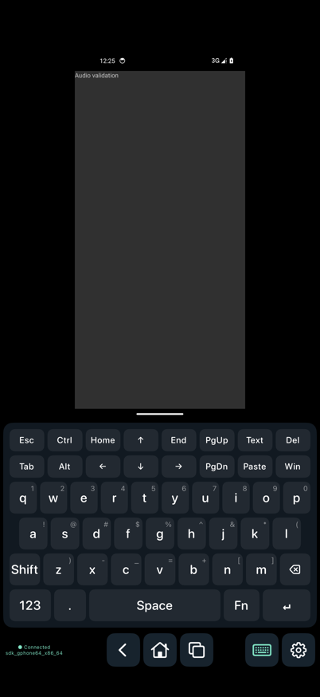
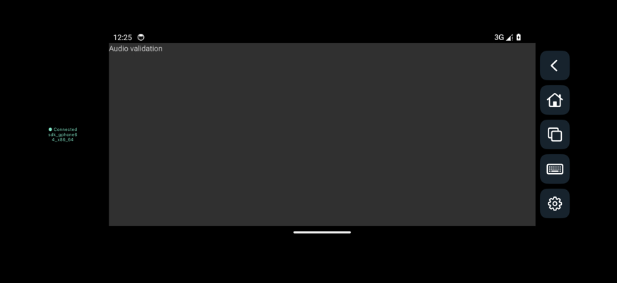

# scrcpy-ios

[简体中文](README.md) · [Documentation](docs/README.md) · [Android app](https://github.com/felix021/scrcpy-apk)

View and control an Android phone from an iPhone or iPad. Native SwiftUI interface, direct network ADB, and system VideoToolbox decoding; no relay server required.

**0.2.0 development version**, not yet available on the App Store. Requires iOS / iPadOS 16 or later.

- Android 11+ wireless debugging: QR code / six-digit pairing code, TLS 1.3 connections, and a customizable client name.
- Multiple connection profiles, including host, port, video quality and control options.
- H.264 / H.265 video, touch, multitouch, Back / Home / Recents.
- Six-row QWERTY keyboard: two control rows, three letter/symbol rows, and a bottom row with Space and Enter. Ctrl / Alt / Shift / Win / Fn; swipe up for symbols, down for capitals.
- Inward edge gestures: either side for Back, bottom for Home, top for Quick Settings. Adaptive landscape layout, optional orientation sync and manual rotation.
- Independent remote audio and local microphone switches. Remote playback defaults on; microphone forwarding defaults off.
- Runtime settings, view-only mode, keep-awake, disconnect confirmation, and English / Simplified Chinese with system-language support.





## Connect

1. Enable **Wireless debugging** in Android 11+ Developer options. Tap **Pair wireless debugging** in the app: scan the iOS QR code with Android, or enter the address, port and six-digit code from Android’s pairing dialog. QR discovery requires the same local network.
2. After pairing, use the discovered connection port, or enter it from Android’s main Wireless debugging page. The connection and pairing ports are different.
3. Allow Local Network access on iOS. Customize **This device’s name** in Settings to identify the client in Android’s paired-device list.

Classic TCP ADB remains available: run `adb tcpip 5555` from a computer, enter the device address / port, and approve debugging on Android. Direct USB connection is unavailable on iOS. See [usage and limits](docs/usage.md) (Chinese).

## Build

Install Xcode and [XcodeGen](https://github.com/yonaskolb/XcodeGen) on a Mac, then run:

```sh
scripts/build-ios.sh simulator  # Generate project and build simulator app
scripts/build-ios.sh device     # Build an unsigned device IPA
```

The script downloads pinned Android services and verifies SHA-256. Generated JARs, Xcode projects, build outputs and signing materials stay out of Git. Device installation requires your own Apple signing. Use `scripts/sign-ios.py` for registered Ad Hoc devices; see [building](docs/building.md) (Chinese).

## License

The client is licensed under [GPL-3.0](LICENSE). The bundled official scrcpy server is Apache-2.0; the microphone service comes from the GPL-3.0 Android app. See [licenses and corresponding source](docs/licensing.md) for versions and notices.
