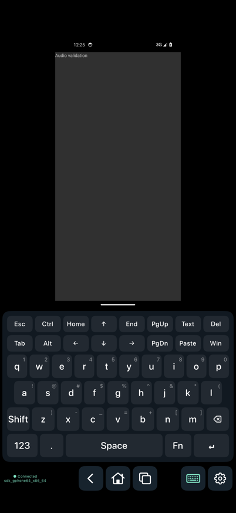
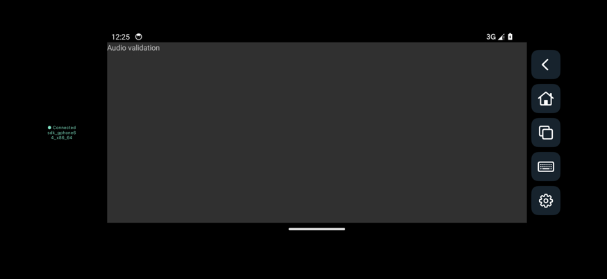

# scrcpy-ios

[English](README.en.md) · [文档](docs/README.md) · [Android 版](https://github.com/felix021/scrcpy-apk)

用 iPhone 或 iPad 查看和控制 Android 手机。原生 SwiftUI 界面，通过网络 ADB 连接；视频使用系统 VideoToolbox 解码，无需中转服务器。

当前版本为 **0.1.0 开发版**，尚未发布到 App Store。最低 iOS / iPadOS 16。

- 多主机连接配置，保存主机、端口、画质与控制选项。
- H.264 / H.265 视频、触摸、多点触控、返回 / Home / 最近任务。
- 六行 QWERTY 键盘：两行控制键、三行字母及符号、含空格与回车的底行；支持 Ctrl / Alt / Shift / Win / Fn、上滑符号、下滑大写。
- 边缘滑动：左右返回、底部 Home、顶部控制中心；支持横竖屏布局、可选方向同步和手动旋转。
- 远端系统声音播放与本机麦克风转发分别开关；默认播放远端声音，麦克风默认关闭。
- 运行时设置、仅观看、保持唤醒、断开二次确认，中英文界面跟随系统或手动选择。





## 连接

1. Android 开启 USB 调试，用电脑执行 `adb tcpip 5555`，确保手机与 iOS 设备处于可互通的可信网络。
2. 在 App 输入 Android 的 IP / 主机名和 ADB 端口，点击「连接设备」。
3. 首次连接在 Android 上允许调试，iOS 上允许本地网络访问。

目前连接经典 TCP ADB；**尚未实现 Android 11+ 无线调试的配对码 / TLS 配对**。iOS 版也暂不提供 Android 版的 USB 直连。声音与麦克风能力取决于 Android 版本及厂商实现，详见 [使用说明](docs/usage.md)。

## 构建

在 Mac 安装 Xcode 和 [XcodeGen](https://github.com/yonaskolb/XcodeGen)，然后：

```sh
scripts/build-ios.sh simulator  # 生成工程并构建模拟器 App
scripts/build-ios.sh device     # 生成未签名设备 IPA
```

脚本下载固定版本的 Android 服务并校验 SHA-256。JAR、Xcode 工程、构建产物及签名材料均不提交。真机安装需自己的 Apple 签名，见 [构建与签名](docs/building.md)。

## 许可

客户端使用 [GPL-3.0](LICENSE)。随包的官方 scrcpy 服务为 Apache-2.0，麦克风服务来自 GPL-3.0 的 Android 版；具体版本、许可证和源码见 [开源与分发](docs/licensing.md)。
